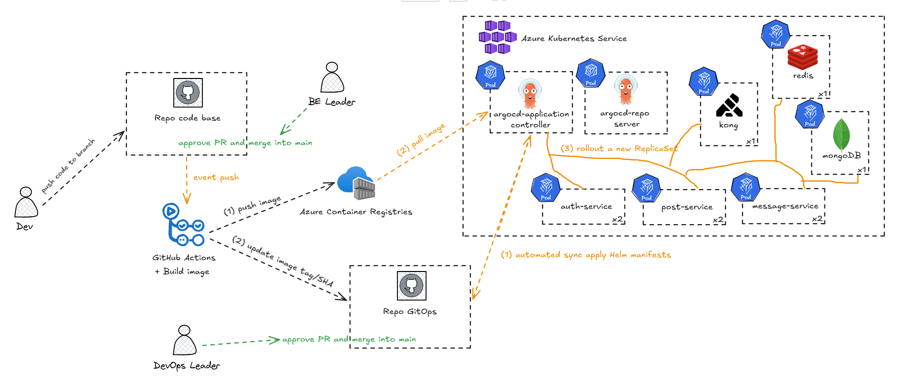

# Microservice Social Learn GitOps

GitOps repository for deploying Social Learn to Azure Kubernetes Service (AKS). This repository contains the Helm chart, environment configuration, and Argo CD `Application` manifests; source code and image-build workflows live in a separate code repository.

## Architecture



Deployment flow:

1. A developer opens a pull request in the source-code repository. After approval, the pull request is merged into `main`.
2. GitHub emits a `push` event; GitHub Actions in the source repository builds a container image and pushes it to Azure Container Registry (ACR) with an immutable commit-SHA tag.
3. The workflow updates the corresponding service image tag in this GitOps repository and creates a commit or pull request against `main`.
4. Argo CD detects the new GitOps revision, renders the Helm chart, and compares the desired state with AKS.
5. `argocd-application-controller` performs automated sync. Kubernetes creates a new ReplicaSet and rolls out Pods whose Pod template changed.

Argo CD can detect commits through a GitHub webhook for immediate refreshes or by polling the Git repository as a fallback. Automated sync applies changes from Git, while `selfHeal` restores resources changed directly in the cluster to the state declared in Git.

## Repository structure

```text
.
├── apps/microservice-social-learn/
│   ├── Chart.yaml
│   ├── values.yaml            # Shared values
│   ├── values-dev.yaml        # Development overrides
│   ├── values-prod.yaml       # Production overrides
│   └── templates/             # Helm-rendered Kubernetes manifests
├── argocd/applications/
│   ├── social-app-dev.yaml
│   └── social-app-prod.yaml
└── asserts/architecture.png
```

## Deployed workloads

With `values-dev.yaml`, the chart creates Deployments for:

- Application workloads: `kong`, `auth-service`, `upload-service`, `notification-service`, `post-service`, `message-service`, `recomment-service`.
- Infrastructure workloads: `mongodb`, `redis`, `zookeeper`, `kafka`.

Application services read their image repository and tag from `values-dev.yaml`. Therefore, a commit that changes only the `post-service` tag rolls out only the `post-service` Deployment; Deployments whose Pod template does not change are not restarted.

## Environments and Argo CD

| Environment | Argo CD Application | Namespace | Helm values |
|---|---|---|---|
| Development | `social-app-dev` | `social-app-dev` | `values.yaml`, `values-dev.yaml` |
| Production | `social-app-prod` | `social-app-prod` | `values.yaml`, `values-dev.yaml`, `values-prod.yaml` |

Both Applications enable automated sync, pruning, and self-healing. Apply the required Application manifest after Argo CD is installed:

```bash
kubectl apply -f argocd/applications/social-app-dev.yaml
kubectl -n argocd get application social-app-dev --watch
```

## Secret management

Do not commit secret values to this repository. Workloads expect a Kubernetes Secret named `social-app-secret` in the target namespace. Development currently references at least:

```text
JWT_SECRET
JWT_REFRESH_SECRET
SUPABASE_URL
SUPABASE_ANON_KEY
```

Create or synchronize this Secret outside Git, preferably from Azure Key Vault through External Secrets. The CI identity that updates this repository should have only the minimum permissions required to update the intended GitOps files.

The image-pull credential for ACR must also be managed outside Git. Prefer AKS-to-ACR managed identity integration; if using `imagePullSecrets`, create the Docker registry Secret directly in the workload namespace.

## Local validation

Render and validate the development chart before opening a GitOps pull request:

```bash
helm lint apps/microservice-social-learn
helm template social-app apps/microservice-social-learn \
  --values apps/microservice-social-learn/values.yaml \
  --values apps/microservice-social-learn/values-dev.yaml
```

## Operational checks

```bash
# Argo CD components and Application status
kubectl -n argocd get pods
kubectl -n argocd get application social-app-dev

# Follow the controller responsible for reconciliation and sync
kubectl -n argocd logs deploy/argocd-application-controller --follow

# Workloads deployed in development
kubectl -n social-app-dev get deployments,pods,services
```

## Production notes

- Require review and approval before merging production GitOps changes.
- Use immutable image tags, such as the source commit SHA; do not deploy mutable tags such as `latest`.
- Roll back configuration by reverting the GitOps commit, then let Argo CD sync the reverted desired state.
- MongoDB, Redis, Kafka, and Zookeeper are stateful systems. For production, use managed services or dedicated StatefulSet/operator-based deployments with persistent storage, backup, and recovery policies.


